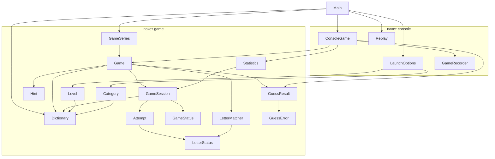
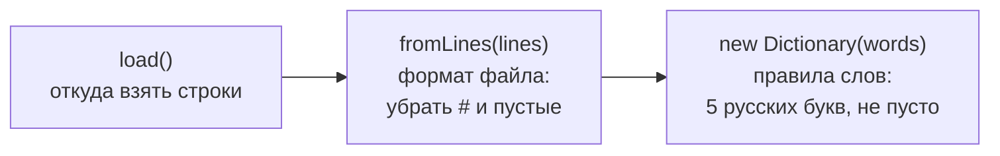
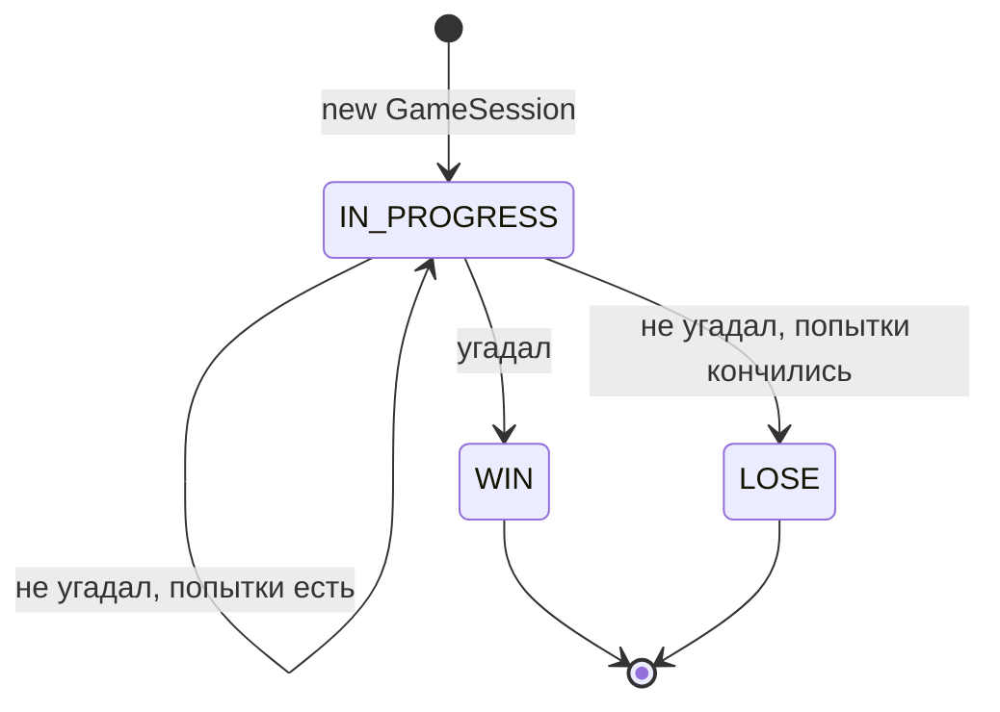
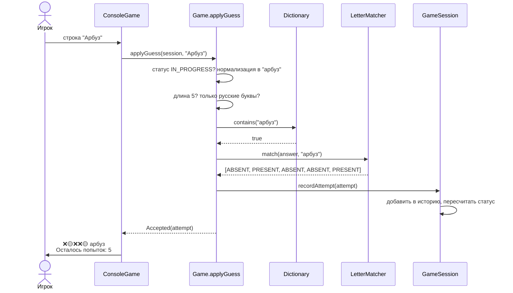

# Подготовка к защите: «5 букв»

Этот файл только для тебя. Он лежит в корне проекта, но в git не попадёт: он добавлен в локальный список исключений `.git/info/exclude`.

Диаграммы написаны на Mermaid. IntelliJ IDEA показывает их в предпросмотре Markdown, если включить Settings → Languages & Frameworks → Markdown → Mermaid.

Номеров строк здесь нет: они сдвигаются после каждой правки. Ищи код по имени класса и метода. Подробности про бонусы лежат в `BONUSES.md`, здесь только то, что нужно для защиты.

## Содержание

1. Задача целиком
2. Карта проекта
3. В каком порядке читать файлы
4. MR1: словарь, seed, партия
5. MR2: проверка ввода и подсчёт букв
6. MR3: консоль, меню, запуск
7. Тесты
8. Сборка, линтеры и CI
9. История с кодировками
10. Java, которая встречается в проекте
11. Вопросы на развитие решения
12. Слабые места, о которых лучше сказать самому
13. Что делал ИИ и как это проверялось
14. Короткие ответы на частые вопросы
15. Сценарий демонстрации
16. Правки после проверки и бонусы

---

## 1. Задача целиком

Консольный Wordle на русском. Программа загадывает слово из 5 букв, у игрока 6 попыток. После каждой попытки она печатает ✅ (буква на месте), 🟡 (буква есть, но в другом месте) или ❌ (буквы нет).

Работа сдавалась тремя MR:

| MR | Что требовалось | Баллы |
|---|---|---|
| MR1 | словарь, выбор слова по seed, модель партии `GameSession` | 23 |
| MR2 | `applyGuess`, проверка ввода, ✅🟡❌ с повторами, победа и поражение | 33 |
| MR3 | меню, несколько игр подряд, формат вывода, детерминированный режим | 23 |
| тесты | обязательные тесты в `mandatory` | 17 |
| README | описание проекта | 4 |

На защите проверяют две вещи. Первая: понимаешь ли ты свой код и почему он устроен именно так. Вторая: можешь ли ты его развить, то есть сказать, что и где поменять, если изменится требование. От второй части зависит, будет потолок 100 или 80. Поэтому в разделе 11 собраны вопросы на развитие с ответами.

---

## 2. Карта проекта

Код разделён на два пакета и точку входа.

`academy.fiveletters.game` содержит правила игры. Он ничего не знает о консоли: не читает с клавиатуры и ничего не печатает. Поэтому его легко тестировать и можно подключить к любому интерфейсу.

`academy.fiveletters.console` содержит консольный интерфейс. Он читает строки, вызывает методы из `game` и печатает результат. Правил игры в нём нет.

`Main` соединяет всё вместе: разбирает аргументы, загружает словарь и запускает консоль.



Стрелка означает «знает о». Обрати внимание: ни одна стрелка не идёт из `game` в `console`. Это и есть разделение логики и ввода-вывода из требований MR2. Все константы лежат в классе `academy.fiveletters.Constants`, его используют оба пакета. На схеме он не показан, чтобы не загромождать её.

| Файл | Что делает | MR |
|---|---|---|
| `game/Dictionary.java` | список слов, загрузка и проверка | 1 |
| `game/GameStatus.java` | `IN_PROGRESS`, `WIN`, `LOSE` | 1 |
| `game/GameSession.java` | одна партия и её инварианты | 1, 2 |
| `game/Game.java` | `startGame` и `applyGuess` | 1, 2 |
| `game/LetterStatus.java` | `CORRECT`, `PRESENT`, `ABSENT` и их значки | 2 |
| `game/LetterMatcher.java` | подсчёт ✅🟡❌ | 2 |
| `game/Attempt.java` | одна попытка: слово и статусы букв | 2 |
| `game/GuessError.java` | причины отказа | 2 |
| `game/GuessResult.java` | результат `applyGuess`: принят или отклонён | 2 |
| `game/GameSeries.java` | серия партий из одного seed, seed последней партии | 3 |
| `console/LaunchOptions.java` | разбор аргументов запуска | 3 |
| `console/ConsoleGame.java` | меню, цикл партий, вывод, подсказка, статистика, запись | 3 |
| `Main.java` | точка входа: обычная игра или повтор | 3 |
| `Constants.java` | все константы | после ревью |
| `game/Level.java` | уровни сложности | бонус |
| `game/Category.java` | категории слов | бонус |
| `game/Hint.java` | подсказка: место и буква | бонус |
| `game/Statistics.java` | статистика за запуск | бонус |
| `console/Replay.java` | файл повтора: запись и чтение | бонус |
| `console/GameRecorder.java` | интерфейс «сохрани партию» | бонус |

---

## 3. В каком порядке читать файлы

Читай в порядке MR. Так ты повторишь путь, по которому проект строился, и вопросы ментора, скорее всего, пойдут в том же порядке.

1. `README.md`, чтобы вспомнить общую картину. (прочитал)
2. `src/main/resources/dictionary.txt`, первые 10 строк. Посмотри формат.
3. `Dictionary.java` целиком.
4. `GameStatus.java`, `GameSession.java`.
5. `Game.java`, только `startGame`.
6. Тесты MR1: `mandatory/mr1/DictionaryTest`, `mandatory/mr1/SeedTest`.
7. `LetterStatus.java`, `LetterMatcher.java`. Это главное место всего проекта. Прогони алгоритм на бумаге по разделу 5.2.
8. `Attempt.java`, `GuessError.java`, `GuessResult.java`.
9. `Game.java`, метод `applyGuess`.
10. Тесты MR2: `mandatory/mr2/*`, `game/LetterMatcherTest`.
11. `GameSeries.java`, `LaunchOptions.java`.
12. `ConsoleGame.java` целиком.
13. `Main.java`.
14. Тесты MR3: `mandatory/mr3/MenuTest`, `console/ConsoleGameTest`.
15. `build.gradle.kts` и `.gitlab-ci.yml` бегло, по разделу 8.
16. `Constants.java` и раздел 16 этого файла: правки после ревью.
17. `BONUSES.md`, потом `Level`, `Category`, `Statistics`, `Hint`, `Replay`, `GameRecorder` и тесты к ним.

---

## 4. MR1: словарь, seed, партия

### 4.1 Файл словаря

`src/main/resources/dictionary.txt` содержит 644 слова. Одно слово в строке, нижний регистр, без буквы ё. Строки с `#` и пустые строки это комментарии.

Папка `src/main/resources` при сборке попадает внутрь программы (в classpath). Поэтому файл читается не по пути на диске, а как ресурс. Так он найдётся на любом компьютере.

### 4.2 Dictionary

Файл: `game/Dictionary.java`.

Словарь создаётся в три шага. У каждого шага своя ответственность.



Конструктор:

```java
public Dictionary(List<String> candidates) {
    var result = new ArrayList<String>();
    for (var candidate : candidates) {
        var word = candidate.strip().toLowerCase(Locale.ROOT);
        if (word.length() != WORD_LENGTH || !word.matches(RUSSIAN_LETTERS)) {
            throw new IllegalArgumentException("Слово не из " + WORD_LENGTH + " русских букв: '" + candidate + "'");
        }
        result.add(word);
    }
    if (result.isEmpty()) {
        throw new IllegalArgumentException("Словарь пуст");
    }
    this.words = List.copyOf(result);
}
```

На что обратить внимание:

1. Любой способ создать словарь проходит через конструктор. `load` вызывает `fromLines`, а `fromLines` вызывает `new Dictionary`. Значит, непроверенный словарь получить нельзя. Если объект `Dictionary` существует, он правильный.
2. Конструктор принимает готовый список, а не читает файл сам. Поэтому словарь не зависит от источника данных. В тестах его создают прямо из `List.of("озеро", "арбуз")`, без файлов.
3. Слова собираются во временный список `result`, а в поле записываются один раз в конце через `List.copyOf`. В неизменяемый список нельзя добавлять по одному слову, поэтому сначала слова собираются в обычный `ArrayList`, а потом «замораживаются». Ещё две причины: в поле лежат уже нормализованные слова, а не исходные строки, и словарь не хранит чужой список `candidates`, который вызывающий код мог бы потом поменять.
4. Поле в итоге неизменяемое. Поэтому `words()` может отдавать его без копирования, снаружи всё равно нельзя добавить или удалить слово. Весь объект `Dictionary` неизменяемый, его можно спокойно передавать куда угодно.
5. `Locale.ROOT` в `toLowerCase` нужен, чтобы результат не зависел от языка системы. Классический пример: в турецкой локали `I` превращается не в `i`.
6. `WORD_LENGTH` и `RUSSIAN_LETTERS` лежат в `Constants` и подключены через `import static`. Регулярное выражение `[а-я]+` значит «одна или больше букв от а до я». Буква ё в этот диапазон не входит, в Unicode она стоит отдельно. В словаре её нет, так что это не мешает.

Почему неверное слово вызывает ошибку, а не пропускается молча. Это принцип fail fast: лучше упасть при запуске с сообщением, где ошибка, чем потом искать, почему в словаре не хватает слова. При этом комментарии и пустые строки пропускаются: это формат файла, а не ошибка.

`fromLines`: сначала `strip()`, потом проверка на пустоту и `#`. Порядок важен. Без `strip()` строка из пробелов не считалась бы пустой, а `"  # комментарий"` не начиналась бы с `#`.

`load(resource)`. `load()` без аргумента вызывает его с путём `/dictionary.txt`, а категории и уровни загружают так свои файлы:

```java
try (InputStream inputStream = Dictionary.class.getResourceAsStream(resource)) {
    if (inputStream == null) {
        throw new IllegalStateException("Не найден ресурс " + resource);
    }
    var reader = new BufferedReader(new InputStreamReader(inputStream, StandardCharsets.UTF_8));
    return fromLines(reader.lines().toList());
} catch (IOException e) {
    throw new UncheckedIOException("Не удалось прочитать словарь", e);
}
```

- `getResourceAsStream` возвращает `null`, если ресурса нет. Без проверки на `null` сборку остановит NullAway.
- `try (...)` это try-with-resources: поток закроется сам, даже если внутри случится ошибка.
- Кодировка UTF-8 указана явно. Иначе Java взяла бы системную, и на Windows русские буквы прочитались бы неправильно.
- Ловится только `IOException`. Если ловить `Exception`, то ошибка «слово не из 5 букв» из конструктора тоже попала бы в `catch` и превратилась бы в обманчивое «Не удалось прочитать словарь». Правило: лови только то, что умеешь осмысленно обработать.
- `IOException` проверяемое исключение. Его пришлось бы объявлять в сигнатуре каждого метода по цепочке вверх. Поэтому оно оборачивается в непроверяемое `UncheckedIOException`: без словаря игра всё равно работать не может.
- Откуда здесь `IOException`. Компилятор требует его обработать из-за метода `close()`, который try-with-resources вызывает сам, а `InputStream.close()` объявлен с `throws IOException`. Ошибки при чтении строк `reader.lines()` уже сам оборачивает в `UncheckedIOException`.
- `reader.lines()` возвращает ленивый `Stream<String>`, а `.toList()` сразу читает все строки в список. Это важно: после выхода из `try` поток файла закрыт, и ленивый `Stream` прочитать было бы уже нельзя.

Ещё у словаря есть `filter(условие)` (отобрать слова, порядок сохраняется) и `containsAll(другой словарь)`. Они нужны уровням и категориям.

`contains` ищет слово в `List` перебором, это O(n). Для 644 слов это мгновенно. Если словарь станет огромным, можно добавить рядом `Set` для поиска (раздел 11).

### 4.3 GameStatus

Файл: `game/GameStatus.java`. Enum из трёх значений. Почему не `boolean finished`: он не различает победу и поражение. Почему не строка `"WIN"`: опечатка `"WINN"` скомпилируется, а значение enum с опечаткой не соберётся.

### 4.4 GameSession

Файл: `game/GameSession.java`. Это одна партия.

Поля:

```java
private final Dictionary dictionary;
private final String answer;
private final int maxAttempts;
private final List<Attempt> history = new ArrayList<>();
private GameStatus status;
private boolean hintUsed;
```

- `hintUsed` появился с бонусом «подсказка»: использована ли подсказка в этой партии.
- Все поля `private`: снаружи их можно только читать через методы.
- `history` объявлен `final`, но список внутри меняется. `final` запрещает заменить сам список на другой, но не запрещает добавлять в него элементы.
- `status` не `final`, потому что меняется по ходу партии.
- Ссылка на словарь хранится потому, что задание требует сигнатуру `applyGuess(session, guess)`. Словаря среди параметров нет, а проверять «слово есть в словаре» надо. Значит, он должен быть доступен через `session`. Это ссылка, а не копия 644 слов.
- Отдельного поля `attemptsUsed` нет. Метод `attemptsUsed()` возвращает `history.size()`. Если хранить счётчик отдельно, однажды его забудут увеличить, и два значения разойдутся. Правило: не храни то, что можно посчитать.
- В задании поле называется `attemptsHistory`, у нас метод `history()`. Смысл тот же, это указано в описании MR1.

Конструктор проверяет инварианты:
- `maxAttempts <= 0` даёт `IllegalArgumentException`;
- слова нет в словаре даёт `IllegalArgumentException`. Отдельно проверять «5 букв» не нужно: в словаре только такие слова;
- статус сразу `IN_PROGRESS`.

Инвариант это утверждение, которое верно всегда, пока объект существует. Если проверять его в конструкторе, неправильный объект просто нельзя создать.

`this` в конструкторе обязателен, потому что параметры называются так же, как поля. `this.answer = answer` значит «поле равно параметру». Без `this` параметр присвоился бы сам себе, а поле осталось бы пустым.

`recordAttempt`:

```java
void recordAttempt(Attempt attempt) {
    if (status != GameStatus.IN_PROGRESS) {
        throw new IllegalStateException("Партия уже завершена со статусом " + status + ", новые попытки не принимаются");
    }
    history.add(attempt);
    if (attempt.guess().equals(answer)) {
        status = GameStatus.WIN;
    } else if (attemptsUsed() == maxAttempts) {
        status = GameStatus.LOSE;
    }
}
```

- Порядок проверок важен. Сначала победа, потом поражение. Если игрок угадал на шестой, последней попытке, это победа. При обратном порядке он бы «проиграл», угадав слово.
- У метода нет модификатора доступа, это package-private: его видят только классы из пакета `game`. Записывать попытку должен только `Game.applyGuess`, после проверки ввода. Консоль не может вызвать `recordAttempt("абв")` в обход проверок, поэтому правило «неверный ввод не тратит попытку» защищено самой структурой кода.
- `IllegalStateException` значит «данные нормальные, но сейчас не время». `IllegalArgumentException` значит «передали плохие данные». Аналогия: заказать минус три кофе это плохой аргумент, а заказать кофе в закрытом кафе это неправильное состояние.

`history()` возвращает `List.copyOf(history)`. Наружу уходит неизменяемая копия, чужой код не испортит историю.

Жизнь партии это конечный автомат:



Из `WIN` и `LOSE` переходов нет. Это и есть инвариант «завершённая игра не принимает попытки».

### 4.5 Game.startGame и seed

Файл: `game/Game.java`.

```java
public static GameSession startGame(Dictionary dictionary, int maxAttempts, long seed) {
    return startGame(dictionary, dictionary, maxAttempts, seed);
}

public static GameSession startGame(Dictionary dictionary, Dictionary answers, int maxAttempts, long seed) {
    var words = answers.words();
    var random = new Random(seed);
    var answer = words.get(random.nextInt(words.size()));
    return new GameSession(dictionary, answer, maxAttempts);
}
```

`Random` не настоящая случайность, а формула. Из стартового числа seed она выдаёт цепочку чисел, похожих на случайные. Алгоритм `Random` закреплён в документации Java, поэтому одинаковый seed даёт одинаковую цепочку на любой JVM.

Одинаковый seed даёт одинаковый номер слова. Чтобы под этим номером всегда было одно и то же слово, порядок слов тоже должен быть фиксированным. Поэтому словарь хранит `List` в порядке файла. У `HashSet` порядок обхода не гарантирован: он зависит от хешей и внутреннего размера таблицы и может измениться, например, в другой версии Java. Опираться на негарантированное поведение нельзя.

Зачем seed вообще нужен. Тест не может проверить «выбрано какое-то слово», ему нужно знать какое. А если кто-то сообщит о баге, по seed можно воспроизвести ту же игру.

`Game` это класс без состояния: `final`, приватный конструктор, только статические методы. Объект `Game` создать нельзя. Checkstyle требует приватный конструктор у таких классов (правило HideUtilityClassConstructor).

Обязательная сигнатура `startGame(dictionary, maxAttempts, seed)` осталась. Она вызывает вторую версию, где ответ выбирается из отдельного набора `answers` (для уровней и категорий), а ввод проверяется по всему `dictionary`. Без уровня и категории оба словаря одинаковые, поэтому поведение MR1 не изменилось: при seed 42 первое слово по-прежнему `шоссе`.

`DEFAULT_MAX_ATTEMPTS = 6` лежит в `Constants`, чтобы число 6 не повторялось по коду.

Проверку `maxAttempts > 0` делает конструктор `GameSession`, в `startGame` её повторять не нужно.

---

## 5. MR2: проверка ввода и подсчёт букв

### 5.1 LetterStatus

Файл: `game/LetterStatus.java`. Enum с полем: у каждого значения свой значок.

```java
CORRECT("✅"), PRESENT("🟡"), ABSENT("❌");
private final String symbol;
LetterStatus(String symbol) { this.symbol = symbol; }
```

Конструктор enum вызывается автоматически, по одному разу для каждого значения.

### 5.2 LetterMatcher: главное место проекта

Файл: `game/LetterMatcher.java`. Про него спросят почти наверняка.

Правило из задания: каждая буква ответа расходуется один раз. Сначала отмечаются все ✅, и только оставшимися буквами закрываются 🟡.

Наивный способ «есть ли буква где-то в слове» даёт неправильный ответ на повторах. Поэтому алгоритм делает два прохода и считает свободные буквы.

```java
List<LetterStatus> statuses = new ArrayList<>(Collections.nCopies(answer.length(), LetterStatus.ABSENT));
List<Integer> unmatchedPositions = new ArrayList<>();
Map<Character, Integer> freeLetters = new HashMap<>();

for (int i = 0; i < answer.length(); i++) {
    if (answer.charAt(i) == guess.charAt(i)) {
        statuses.set(i, LetterStatus.CORRECT);
    } else {
        unmatchedPositions.add(i);
        freeLetters.merge(answer.charAt(i), 1, Integer::sum);
    }
}

for (int i : unmatchedPositions) {
    char letter = guess.charAt(i);
    if (freeLetters.getOrDefault(letter, 0) > 0) {
        statuses.set(i, LetterStatus.PRESENT);
        freeLetters.merge(letter, -1, Integer::sum);
    }
}
return List.copyOf(statuses);
```

Что здесь происходит:

- `statuses` сразу заполнен `ABSENT` через `Collections.nCopies`. Поэтому ❌ ставить отдельно не нужно: всё, что не стало ✅ или 🟡, останется ❌.
- Первый проход. Если буквы на позиции совпали, ставим ✅. Если нет, запоминаем позицию и добавляем букву ответа в счётчик свободных.
- `freeLetters.merge(key, 1, Integer::sum)` значит: если ключа нет, положить 1, а если есть, прибавить 1. Так считается, сколько раз каждая буква ответа осталась свободной.
- Второй проход идёт только по позициям без ✅. Если буква ввода есть среди свободных (счётчик больше нуля), ставим 🟡 и уменьшаем счётчик на 1.
- `getOrDefault(letter, 0)` возвращает 0, если такой буквы в словаре нет.
- Проверка длины в начале нужна, чтобы при разной длине слов метод бросил понятное исключение, а не упал на `charAt` с непонятной ошибкой.
- Метод не знает ни про словарь, ни про игру. Это чистая функция: получила две строки, вернула результат. Поэтому её можно проверить на `оооом`, которого нет в словаре.

Сложность O(n), где n длина слова.

Пример 1. Загадано `сорок`, ввод `оооом`.

| позиция | 1 | 2 | 3 | 4 | 5 |
|---|---|---|---|---|---|
| ответ | с | о | р | о | к |
| ввод | о | о | о | о | м |
| первый проход | | ✅ | | ✅ | |

После первого прохода свободные буквы ответа: с, р, к (по одной). Буквы о среди них нет: обе о ответа ушли на ✅.

Второй проход: позиция 1, буква о, свободных о нет, остаётся ❌. Позиция 3 так же. Позиция 5, буква м, её нет, ❌.

Итог `❌✅❌✅❌`. Наивный способ дал бы `🟡✅🟡✅❌`.

Пример 2. Загадано `озеро`, ввод `сорок`. Тут наоборот, в ответе две о.

Совпадений на местах нет. Свободные буквы ответа: о дважды, з, е, р. Второй проход: с ❌; о 🟡 (о осталась одна); р 🟡; о 🟡 (о больше нет); к ❌. Итог `❌🟡🟡🟡❌`. Обе о получили 🟡, потому что в ответе их две.

Пример 3. Загадано `арбуз`, ввод `бабах`. Буква б на позиции 3 совпала, ✅. Свободные: а, р, у, з. Позиция 1, буква б: свободных б нет (единственная б ушла на ✅), ❌. Позиция 2, а: свободна, 🟡, теперь а кончились. Позиция 4, а: свободных нет, ❌. Итог `❌🟡✅❌❌`. Здесь видно, почему ✅ отмечаются первыми: иначе б на позиции 1 могла бы забрать букву, которая нужна для ✅ на позиции 3.

Эти случаи проверяются в `game/LetterMatcherTest`.

### 5.3 Attempt

Файл: `game/Attempt.java`.

```java
public record Attempt(String guess, List<LetterStatus> statuses) {
    public Attempt {
        statuses = List.copyOf(statuses);
    }
}
```

`record` это короткая запись класса-данных. Java сама создаёт `private final` поля, конструктор, методы `guess()` и `statuses()`, а также `equals`, `hashCode` и `toString`.

Блок `public Attempt { ... }` это компактный конструктор. Он выполняется перед записью полей. Здесь он делает защитную копию списка. Без неё поле `final` защищало бы только ссылку: если снаружи передали изменяемый список и потом его поменяли, поменялась бы и попытка.

В MR1 история хранила строки. В MR2 она хранит `Attempt`, потому что для вывода `❌🟡❌❌🟡 арбуз` нужны и слово, и статусы.

### 5.4 GuessError и GuessResult

Файлы: `game/GuessError.java`, `game/GuessResult.java`.

```java
public sealed interface GuessResult {
    record Accepted(Attempt attempt) implements GuessResult {}
    record Rejected(GuessError error) implements GuessResult {}
}
```

У ввода два исхода: принят или отклонён. `sealed` значит, что других вариантов нет и не будет: реализовать `GuessResult` могут только эти два record'а. Компилятор это знает и проверяет, что `switch` по `GuessResult` разбирает оба случая (раздел 6.3).

Почему неверный ввод возвращает `Rejected`, а не бросает исключение. Исключение нужно для того, что не должно случаться, то есть для ошибок программиста. Опечатка игрока это обычная ситуация, она будет происходить постоянно. Если бы `applyGuess` бросал исключение, консоли пришлось бы ловить его на каждой опечатке, и обычная логика превратилась бы в обработку ошибок.

Почему не `null` и не `boolean`. По `boolean` нельзя понять причину отказа. `null` легко забыть проверить, и NullAway его не любит.

`GuessError` это причины отказа. Консоль превращает их в сообщения для игрока, а тесты проверяют конкретную причину.

Record'ы сравниваются по содержимому. Поэтому в тестах можно писать `isEqualTo(new GuessResult.Rejected(GuessError.WRONG_LENGTH))`.

#### Что такое интерфейс

Интерфейс это тип, который описывает роль: что объект умеет или кем он является. Как именно он это делает, интерфейс не говорит. Класс берёт на себя эту роль словом `implements` («реализует»). После этого объект класса можно положить в переменную типа интерфейса.

Если знаешь C++: интерфейс похож на абстрактный класс, где все функции чисто виртуальные. `implements` похоже на публичное наследование от него.

Простой пример не из проекта:

```java
interface Shape {
    double area();
}

record Circle(double radius) implements Shape {
    public double area() {
        return Math.PI * radius * radius;
    }
}

record Square(double side) implements Shape {
    public double area() {
        return side * side;
    }
}

Shape shape = new Circle(1);
shape.area();   // вызовется площадь круга
```

`Shape` обещает: «у меня есть метод `area()`». `Circle` и `Square` выполняют обещание каждый по-своему. Код, который работает с `Shape`, не знает и не должен знать, круг перед ним или квадрат.

Интерфейсы в проекте уже встречались, просто не назывались так:

- `List` это интерфейс. `ArrayList` его реализует, и объект `List.copyOf` тоже, хотя это другой класс. Поэтому можно писать `List<String> words = new ArrayList<>()`. Остальной код работает с `List` и не знает, какой класс внутри.
- `Supplier<GameSession>` в `ConsoleGame` это интерфейс с одним методом `get()`. Ссылка на метод `series::next` создаёт объект, который его реализует. `ConsoleGame` вызывает `sessions.get()` и не знает, откуда берутся партии.
- `AutoCloseable` это интерфейс с методом `close()`. try-with-resources принимает любой объект, который его реализует.

#### Зачем интерфейс в GuessResult, если в нём нет методов

В `GuessResult` нет ни одного метода. Здесь интерфейс нужен не для поведения, а как общий тип для двух разных классов.

Метод `applyGuess` может вернуть одно из двух: `Accepted` с попыткой или `Rejected` с причиной. Это два разных класса с разными полями. Но у метода может быть только один тип результата. Значит, нужен тип, который означает «либо `Accepted`, либо `Rejected`». Этим типом и служит `GuessResult`: оба record'а его реализуют, поэтому оба можно вернуть из метода с типом `GuessResult`.

```java
public static GuessResult applyGuess(GameSession session, String guess) {
    ...
    return new GuessResult.Rejected(GuessError.WRONG_LENGTH);   // объект Rejected, он же GuessResult
    ...
    return new GuessResult.Accepted(attempt);                   // объект Accepted, он же GuessResult
}
```

Без общего интерфейса тип результата пришлось бы объявить как `Object`, и компилятор ничем бы не помогал.

Record'ы объявлены внутри интерфейса, чтобы держать варианты рядом с общим типом. Вложенные в интерфейс типы автоматически публичные и статические, поэтому снаружи к ним обращаются как `GuessResult.Accepted` и `GuessResult.Rejected`.

#### Что добавляет sealed

Обычный интерфейс может реализовать кто угодно, в любом месте программы. `sealed` закрывает список: реализовать `GuessResult` могут только типы, перечисленные в нём. Если они объявлены в том же файле, как у нас, перечислять их отдельно не нужно.

Компилятор знает, что вариантов ровно два, и это используется при разборе результата.

#### Как результат используется

Тот, кто получил `GuessResult`, должен узнать, какой из двух вариантов пришёл, и достать данные. В `ConsoleGame.playGame` это сделано через `switch`:

```java
switch (Game.applyGuess(session, guess)) {
    case GuessResult.Accepted(Attempt attempt) -> printAttempt(session, attempt);
    case GuessResult.Rejected(GuessError error) -> out.println(errorMessage(error));
}
```

`case GuessResult.Accepted(Attempt attempt)` делает две вещи сразу: проверяет, что объект это `Accepted`, и кладёт его поле в переменную `attempt`. Это называется деконструкцией record'а (Java 21).

`default` не нужен: из-за `sealed` компилятор знает, что других вариантов нет. Если добавить третий вариант, например `GuessResult.Hint`, этот `switch` перестанет компилироваться, пока его не обработаешь. Забыть обработку нельзя.

То же самое старым способом, через `instanceof`:

```java
GuessResult result = Game.applyGuess(session, guess);
if (result instanceof GuessResult.Accepted accepted) {
    printAttempt(session, accepted.attempt());
} else if (result instanceof GuessResult.Rejected rejected) {
    out.println(errorMessage(rejected.error()));
}
```

Работает так же, но если появится третий вариант, компилятор ничего не скажет, и он просто молча не обработается.

#### Почему не методы в интерфейсе

Можно было бы добавить в `GuessResult` метод, например `void show(PrintStream out)`, и реализовать его в каждом record'е по-своему, как `area()` у фигур. Но тогда пакет `game` знал бы, как печатать результат в консоль, а мы специально держим `game` без ввода-вывода. Поэтому варианты результата только несут данные, а что с ними делать, решает консоль через `switch`.

#### Какие были другие варианты

- Один класс с двумя полями, например `GuessResult(@Nullable Attempt attempt, @Nullable GuessError error)`. Тогда возможны бессмысленные состояния: оба поля пустые или оба заполнены. И везде нужны проверки на `null`. С двумя record'ами такое состояние просто нельзя создать.
- Исключение для неверного ввода. Разобрано выше: опечатка это не ошибка программы.
- `Optional<Attempt>`. Он говорит, принят ввод или нет, но теряет причину отказа.

Коротко для защиты:

> `GuessResult` это общий тип для двух вариантов результата: `Accepted` с попыткой и `Rejected` с причиной. Оба record'а его реализуют, поэтому `applyGuess` может вернуть любой из них. `sealed` говорит компилятору, что вариантов только два, поэтому `switch` в консоли обходится без `default`, а новый вариант нельзя забыть обработать. Методов в интерфейсе нет, потому что как реагировать на результат, решает консоль, а не пакет `game`.

### 5.5 Game.applyGuess

Файл: `game/Game.java`.

```java
public static GuessResult applyGuess(GameSession session, String guess) {
    if (session.status() != GameStatus.IN_PROGRESS) {
        throw new IllegalStateException("Партия уже завершена со статусом " + session.status());
    }
    var word = guess.strip().toLowerCase(Locale.ROOT).replace('ё', 'е');
    if (word.length() != WORD_LENGTH) {
        return new GuessResult.Rejected(GuessError.WRONG_LENGTH);
    }
    if (!word.matches(RUSSIAN_LETTERS)) {
        return new GuessResult.Rejected(GuessError.NOT_LETTERS);
    }
    if (!session.dictionary().contains(word)) {
        return new GuessResult.Rejected(GuessError.NOT_IN_DICTIONARY);
    }
    var attempt = new Attempt(word, LetterMatcher.match(session.answer(), word));
    session.recordAttempt(attempt);
    return new GuessResult.Accepted(attempt);
}
```

Шаги по порядку:

1. Партия уже завершена: исключение. Это ошибка в коде, а не игрока. Проверка стоит первой, чтобы даже неверный ввод в завершённой партии давал исключение, а не `Rejected`.
2. Нормализация. `strip` убирает пробелы только по краям, поэтому `до ма` остаётся с пробелом внутри и не проходит проверку на буквы. Сначала `toLowerCase`, потом замена ё. Порядок важен: `Ё` сначала становится `ё`, потом `е`.
3. Длина. Пустая строка и строка из пробелов дают `WRONG_LENGTH`. Обязательный тест ждёт, что `""` это ошибка длины, поэтому длина проверяется первой. Следствие: `дом1` тоже даст `WRONG_LENGTH`, а не `NOT_LETTERS`.
4. Только русские буквы. Латиница, цифры, пробел, дефис дают `NOT_LETTERS`.
5. Слово в словаре.
6. Подсчёт букв, запись попытки, `Accepted`.

`session.recordAttempt` вызывается только в конце, после всех проверок. Поэтому `Rejected` не меняет историю и не тратит попытку.

Победа определяется в `recordAttempt` через `attempt.guess().equals(answer)`. Это корректно, потому что и ввод, и ответ уже нормализованы.

Путь одной попытки через всю программу:



Если на любой проверке ввод не прошёл, `applyGuess` сразу возвращает `Rejected`, и до `LetterMatcher` и `recordAttempt` дело не доходит.

---

## 6. MR3: консоль, меню, запуск

### 6.1 GameSeries

Файл: `game/GameSeries.java`.

```java
public GameSeries(Dictionary dictionary, Dictionary answers, long seed) {
    this.dictionary = dictionary;
    this.answers = answers;
    this.random = new Random(seed);
}

public GameSession next() {
    long seed = random.nextLong();
    lastSeed = seed;
    return Game.startGame(dictionary, answers, DEFAULT_MAX_ATTEMPTS, seed);
}
```

#### Какую задачу решает

`Game.startGame(dictionary, maxAttempts, seed)` создаёт одну партию, и ей нужен seed. Это требование MR1.

В MR3 появилось меню: за один запуск можно сыграть несколько партий. И пользователь передаёт один seed на весь запуск: `--seed 42`. Возникает вопрос: какой seed давать каждой следующей партии?

| Вариант | Что получится |
|---|---|
| Всем партиям один и тот же seed 42 | во всех партиях одно и то же слово |
| Каждой партии случайный seed | слова разные, но запуск с `--seed 42` уже не повторить |
| `42 + номер партии` | работает, но это самодельное правило, его надо где-то хранить и объяснять |
| Один `Random(42)`, который выдаёт seed каждой партии | слова разные, и весь запуск повторяется целиком |

`GameSeries` это последний вариант.

#### Как работает

Стартовый seed задаёт не одно слово, а всю цепочку чисел. `GameSeries` создаёт один `Random(42)` и при каждом вызове `next()` берёт из него следующее число. Это число становится seed'ом новой партии:

```text
new GameSeries(dictionary, 42)      создаётся Random(42)
next()  ->  random.nextLong() = X1  ->  startGame(..., X1)  ->  шоссе
next()  ->  random.nextLong() = X2  ->  startGame(..., X2)  ->  гарем
next()  ->  random.nextLong() = X3  ->  startGame(..., X3)  ->  ...
```

Новый запуск с тем же seed 42 создаёт новый `Random(42)`, он снова выдаёт X1, X2, X3, и слова повторяются в том же порядке.

#### Почему это объект, а не статический метод

У `GameSeries` есть состояние: объект `Random` помнит, на каком месте цепочки он остановился. Между вызовами `next()` это место должно сохраняться, иначе каждый раз получалось бы первое число цепочки и одно и то же слово. Поэтому у `GameSeries` публичный конструктор и поля. Для сравнения, у `Game` состояния нет, и его объект создать нельзя.

#### Почему seed партии, а не сразу слово

`GameSeries` мог бы сам выбирать слово через `random.nextInt(words.size())`. Но тогда логика выбора слова была бы в двух местах: в `startGame` и в `GameSeries`. А так `GameSeries` только раздаёт seed'ы, а слово выбирает `startGame`, как требует MR1. Правило «одинаковый seed даёт одинаковое слово» по-прежнему держится в одном методе.

#### Кто им пользуется

- `Main` создаёт серию и передаёт в консоль `series::next` как `Supplier<GameSession>`. Консоль просит новую партию через `sessions.get()` и ничего не знает о seed'ах.
- Тест `MenuTest` создаёт свою `GameSeries` с тем же seed и узнаёт, какие слова загадает программа. Логику выбора слов тест не повторяет, а использует тот же класс.

`GameSeries` лежит в пакете `game`, потому что это про выбор слов, а не про ввод-вывод.

Для бонусов серия умеет две вещи сверх этого. Второй конструктор принимает отдельный набор ответов `answers` для уровня или категории. Метод `lastSeed()` возвращает seed последней начатой партии: его сохраняет `--record`, и по нему `--replay` начинает ту же партию через `Game.startGame`.

Коротко для защиты:

> Пользователь задаёт один seed на весь запуск, а партий может быть несколько. Если дать им всем этот seed, слово будет одно. `GameSeries` хранит один `Random(seed)` и для каждой новой партии берёт из него следующее число как её seed. Слова разные, а при том же стартовом seed весь запуск повторяется. Слово по-прежнему выбирает `startGame`, поэтому логика выбора не дублируется.

### 6.2 LaunchOptions

Файл: `console/LaunchOptions.java`. Record с полями всех флагов: `seed`, `showAnswer`, `level`, `category`, `color`, `record`, `replay`.

- `Long` с большой буквы, а не `long`: примитив `long` не может быть `null`, а нам нужно различать «seed не задан». Так же `level`, `category` и `replay` бывают `null`.
- `@Nullable` говорит NullAway, что здесь может быть `null`. Без аннотации сборка упала бы.
- Цикл `while` с ручным `i`, а не `for`: флаги со значением (`--seed 42`, `--level easy`) занимают два элемента, флаги без значения (`--color`) один. В `for` пришлось бы менять счётчик внутри тела, а Checkstyle это запрещает (правило ModifiedControlVariable).
- `valueAfter` берёт значение после флага и бросает понятную ошибку, если его нет.
- `parseSeed` ловит `NumberFormatException` и бросает `IllegalArgumentException` с понятным текстом. Исходное исключение передаётся вторым аргументом (cause), чтобы не потерять подробности.
- Флаги можно писать в любом порядке. Неизвестный аргумент даёт ошибку.
- Проверки сочетаний вынесены в `checkCombination`: нельзя `--level` вместе с `--category`, и нельзя `--replay` вместе с `--seed`, `--level`, `--category` или `--record`, потому что они берутся из файла повтора. В отдельный метод их пришлось вынести из-за Checkstyle: в `parse` стало слишком много ветвлений (правило CyclomaticComplexity, максимум 12).

### 6.3 ConsoleGame

Файл: `console/ConsoleGame.java`.

Конструктор получает: откуда брать партии (`Supplier<GameSession>`), откуда читать (`BufferedReader`), куда писать (`PrintStream`), флаги `showAnswer` и `color` и необязательный `GameRecorder` для записи партий. Есть и короткий конструктор без recorder'а, его используют тесты. Класс сам не трогает `System.in` и `System.out`. Это внедрение зависимостей через конструктор. Благодаря ему `ConsoleGameTest` подаёт ввод строкой и читает вывод из памяти, не запуская программу.

`Supplier<GameSession>` это «что-то, что по запросу выдаёт новую партию». Консоль не знает, откуда партии берутся: из seed, с фиксированным словом в тесте или из файла повтора. В `Main` туда передаётся `series::next`, в тесте `() -> new GameSession(dictionary, "озеро", 6)`.

`run` это цикл меню:
- `readLine()` вернул `null`, значит ввод закончился (конец файла, Ctrl+Z). Программа спокойно выходит. Это важно для `TemplateSmokeTest`, который запускает программу вообще без ввода и ждёт код 0.
- `choice.strip()`, поэтому ` 1 ` тоже работает.
- `default` печатает «Нет такого пункта меню» и показывает меню снова. Так выполняется требование «устойчивость к некорректному вводу».
- `playGame` возвращает `false`, если ввод кончился посреди партии. Тогда `run` тоже завершается.
- При выходе через «2» печатается статистика, если были партии.

`playGame(GuessSource guesses)` проводит одну партию. `GuessSource` это закрытый интерфейс «откуда взять следующую строку». В `run` туда передаётся `this::readLine` (клавиатура), в `replay` строки из файла повтора. Поэтому вывод при повторе совпадает с обычной игрой.

Внутри цикла партии:
1. Строка `?` обрабатывается до `applyGuess` и печатает подсказку. Иначе `?` стал бы ошибкой длины.
2. Всё введённое, кроме пустых строк, собирается в список. После конца партии он уходит в `GameRecorder`, если запись включена.
3. Остальное идёт в `Game.applyGuess`:

```java
switch (Game.applyGuess(session, guess)) {
    case GuessResult.Accepted(Attempt attempt) -> printAttempt(session, attempt);
    case GuessResult.Rejected(GuessError error) -> out.println(errorMessage(error));
}
```

Это `switch` с деконструкцией record'ов (Java 21). `case GuessResult.Accepted(Attempt attempt)` проверяет тип и сразу достаёт поле в переменную. `default` не нужен: интерфейс `sealed`, и компилятор знает, что вариантов ровно два. Если добавить третий вариант `GuessResult`, этот `switch` перестанет компилироваться, и забыть его обработать не получится.

После цикла печатается итог: «Победа! Слово угадано за N попыток» или «Неудача. Загаданное слово: ...». Потом партия учитывается в статистике и сохраняется, если включена запись.

`printAttempt`: значки склеиваются через stream (`map(LetterStatus::symbol)`, `Collectors.joining()`). С флагом `--color` слово печатается цветными буквами, цвет выбирает `switch` по `LetterStatus`. Строка «Осталось попыток» печатается, только пока партия идёт.

`errorMessage` это `switch`-выражение по enum. Оно тоже исчерпывающее: добавишь значение в `GuessError`, и компилятор потребует добавить сообщение. Число 5 в сообщениях берётся из `WORD_LENGTH`.

`attemptsPhrase` склоняет слово «попытка»:
- если остаток от деления на 100 от 11 до 14, то «попыток» (11 попыток, 112 попыток);
- иначе по последней цифре: 1 «попытку», 2-4 «попытки», остальное «попыток».

`@SuppressWarnings("checkstyle:MagicNumber")` отключает правило про «магические числа» только для этого метода. Числа 10, 11, 14, 100 здесь и есть правило склонения, выносить их в константы было бы искусственно. HELP.md прямо разрешает такое точечное подавление. Метод package-private, чтобы тест мог проверить его напрямую.

`readLine` оборачивает `IOException` в `UncheckedIOException` и помечен `@Nullable`, потому что при конце ввода возвращает `null`.

### 6.4 Main

Файл: `Main.java`. Метод `main` разбит на несколько коротких методов.

1. `main` оборачивает `System.out` и `System.err` в `PrintStream` с явной кодировкой UTF-8. Так программа не зависит от флагов JVM. Это понадобилось для запуска из IDEA (раздел 9).
2. `main` разбирает аргументы. При ошибке `fail` печатает сообщение и подсказку `USAGE` и завершает программу с кодом 2. `return` после вызова `fail` нужен компилятору: он не знает, что `System.exit` не возвращается, и решил бы, что `options` может остаться неинициализированной.
3. Дальше `main` загружает словарь и выбирает режим: `play` для обычной игры или `replay` для повтора из файла.
4. `play`: если seed не задан, он выбирается случайно и пишется в лог. Лог идёт в stderr (так настроен `logback.xml`), а не в stdout. Вывод игры остаётся чистым, а seed всё равно виден. Потом `answers` выбирает набор ответов по уровню или категории, создаётся `GameSeries`, и, если указан `--record`, лямбда `GameRecorder`, которая сохраняет партию через `Replay` с `series.lastSeed()`.
5. `replay`: читает файл повтора. Отдельно разбирает три ошибки: файла нет (печатается полный путь), файл не прочитался, в файле нет seed. Потом создаёт партию по seed из файла и запускает `ConsoleGame.replay`.
6. `answers` возвращает весь словарь, слова уровня или слова категории и печатает «Уровень: ...» или «Категория: ...».

Почему детерминированный режим через seed, а не `--answer озеро`, объясняется в разделе 9.

`--show-answer` печатает загаданное слово в начале каждой партии. Это удобство для проверки и демонстрации, в бонусы задания он не входит.

Формат вывода из задания и что его печатает:

| Строка | Где |
|---|---|
| `❌🟡❌❌🟡 арбуз` | `printAttempt` |
| `Осталось попыток: 5` | `printAttempt` |
| `Победа! Слово угадано за 4 попытки` | `playGame` |
| `Неудача. Загаданное слово: озеро` | `playGame` |

---

## 7. Тесты

Всего 172 теста. Запуск: `.\gradlew.bat test --rerun`.

### Как они устроены

Обязательные тесты лежат в `mandatory/mr1`, `mr2`, `mr3`. Их названия методов и `@DisplayName` менять было нельзя, по ним ментор сверяется с требованиями. Изначально на них стояли `@Disabled` и `fail(...)`. Теперь `@Disabled` нет ни одного.

Свои тесты лежат в пакетах `game` и `console` в `src/test`. Тесты в пакете `game` видят package-private метод `recordAttempt`, поэтому могут проверять `GameSession` напрямую.

Все тесты построены по схеме Arrange, Act, Assert: подготовка, действие, проверка.

Используется AssertJ: `assertThat(...)`, `assertThatThrownBy(...)`, `containsSubsequence` (строки идут в этом порядке, между ними может быть что-то ещё), `extracting(Attempt::guess)` (взять из каждого элемента одно поле).

Параметризованные тесты (`@ParameterizedTest`) запускают один метод с разными данными: `@ValueSource` даёт список значений, `@CsvSource` строки с несколькими значениями. `name = "{0}"` задаёт, как называется каждый запуск в выводе. В `@DisplayName` подстановка `{0}` не работает, поэтому в обязательных тестах шаблона в выводе остаётся буквальное `{0}`. Мы их не трогали, потому что менять `@DisplayName` обязательных тестов нельзя.

### Что проверяют обязательные тесты

MR1:
- `DictionaryTest`: в загруженном словаре не меньше 50 слов, все слова соответствуют `[а-я]{5}`, пустой словарь даёт исключение.
- `SeedTest`: seed 42 дважды даёт одно слово, seed от 0 до 19 дают больше одного разного слова.

MR2:
- `GuessValidationTest`: партия с настоящим словарём и ответом `озеро`. `дом`, `домики`, `""` дают `WRONG_LENGTH`. `дом12`, `дом!!`, `до ма` дают `NOT_LETTERS`. `абвгд` даёт `NOT_IN_DICTIONARY`. После трёх неверных вводов попыток потрачено 0. `ОЗЕРО` и `озеро` дают одинаковый результат.
- `LetterMatchingTest`: вызывает `LetterMatcher.match` напрямую, потому что `оооом` нет в словаре и через `applyGuess` его не проверить.
- `GameOutcomeTest`: угадал даёт `WIN`. Пять промахов оставляют `IN_PROGRESS`, шестой даёт `LOSE`. После поражения `session.answer()` возвращает ответ (печать ответа появилась в MR3). Попытка в завершённой партии даёт исключение, счётчик не меняется.

MR3, `MenuTest`. Эти тесты запускают программу целиком через `CliRunner`:
- `abc`, `5`, пустая строка, потом `2`: код выхода 0, есть «Нет такого пункта меню».
- Две партии подряд с `--seed 42`. Ответы тест узнаёт через `GameSeries`, первую выигрывает, вторую проигрывает.
- Два запуска с одинаковым seed и вводом дают одинаковый вывод. Плюс проверяется точная строка значков и «Осталось попыток: 5».

### CliRunner

`support/CliRunner.java` дан в шаблоне. Он запускает программу отдельным процессом Java. Отдельный процесс нужен потому, что `System.exit` завершает всю JVM: если вызвать `Main.main` прямо из теста, вместе с программой завершится и прогон тестов. CliRunner передаёт ввод через stdin в UTF-8 и сам добавляет флаги кодировки. Поэтому проблемы с кодировками Windows на тесты не влияют.

`ConsoleGameTest` проверяет консоль без процесса: ввод из `StringReader`, вывод в `ByteArrayOutputStream`. Это быстрее и позволяет подставить партию с известным ответом.

Ещё есть `TemplateSmokeTest` из шаблона: программа без ввода должна завершиться с кодом 0 и что-то напечатать.

Тесты бонусов: `LevelTest`, `CategoryTest`, `HintTest`, `StatisticsTest`, `ReplayTest`, а также новые проверки в `ConsoleGameTest`, `GameSeriesTest`, `LaunchOptionsTest`, `DictionaryValidationTest` и `MainTest`. Что именно они проверяют, перечислено в `BONUSES.md`.

В тестах повтора используется `@TempDir`: JUnit создаёт временную папку и удаляет её после теста. `CliRunner.run(папка, ввод, аргументы)` запускает программу в этой папке, поэтому файлы повторов не остаются в проекте.

---

## 8. Сборка, линтеры и CI

Gradle Wrapper (`gradlew.bat`) сам скачивает нужную версию Gradle (9.7.1). Нужен JDK 25.

На JDK 27 не работает Spotless: форматтер palantir-java-format использует внутренние классы компилятора javac, а в JDK 27 они изменились (ошибка `NoSuchFieldError`). CI собирает проект на образе `gradle:9.7.1-jdk25`.

`.\gradlew.bat check` запускает всё, что проверяет CI:

| Инструмент | Что делает | Где мы с ним встречались |
|---|---|---|
| Spotless | форматирование кода (palantir-java-format) | `spotlessApply` исправляет сам. IDEA форматирует по-своему, поэтому после Ctrl+Alt+L нужен `spotlessApply` |
| Checkstyle | стиль и типичные ошибки | `private` поля, имена без `_`, лишний импорт, магические числа, приватный конструктор у утилитных классов, `"арбуз".equals(answer)` вместо `answer.equals("арбуз")`, слишком сложный метод (CyclomaticComplexity) |
| Error Prone | настоящие баги на этапе компиляции | предупреждения о неиспользуемых полях и переменных |
| NullAway | проверка `null` | `@Nullable` у `readLine` и `seed`, проверка `getResourceAsStream` на `null` |
| JaCoCo | покрытие тестами | процент показывается в CI |

В `build.gradle.kts` стоит обратить внимание на три места:
- `application { mainClass = "academy.fiveletters.Main" }` говорит, что запускать;
- `tasks.named<JavaExec>("run") { standardInput = System.in }` без этой строки `gradlew run` не видел бы ввод с клавиатуры;
- в задаче `test` передаются свойства `academy.cli.classpath` и `academy.cli.mainClass` для `CliRunner`. Поэтому в IDEA тесты нужно запускать через Gradle.

CI (`.gitlab-ci.yml`) запускается только для merge request'ов. Этапы: `build` (компиляция, там работают Error Prone и NullAway), затем параллельно `lint` (Spotless и Checkstyle) и `test` (тесты и покрытие).

Однажды Spotless показывал старую ошибку даже на JDK 25. Gradle взял закэшированный результат прогона на JDK 27 (в `gradle.properties` включён `org.gradle.caching`). Помог один запуск `clean check --no-build-cache`.

---

## 9. История с кодировками

Текст попадает в программу и выходит из неё по трём разным каналам. У каждого своя кодировка, и на твоей Windows все три по умолчанию не UTF-8. Системная кодировка у тебя `Cp1252`, у консоли `437`. В обеих нет русских букв.

| Канал | Что ломалось | Как исправлено |
|---|---|---|
| Вывод в терминал | вместо русских букв мусор | `[Console]::OutputEncoding = UTF8` в профиле PowerShell |
| Вывод при запуске из IDEA | `????? ????` в меню | IDEA запускает `Main` через Gradle без флага `-Dstdout.encoding`. Теперь `Main` сам пишет в UTF-8 |
| Ввод с клавиатуры | `арбуз` приходил как `?????`, ответ «только русские буквы» | `[Console]::InputEncoding = UTF8`. Программа читает ввод в UTF-8 |
| Аргументы запуска | `--answer озеро` приходил как `?????` | в коде не исправить, поэтому seed |

Почему `--answer` не починить. Java на Windows переводит аргументы командной строки в системную кодировку ещё до запуска программы. В `Cp1252` нет русских букв, и слово превращается в знаки вопроса. Лаунчер Java на Windows ещё и раскрывает `?` как шаблон имён файлов, поэтому `?????` превращался в имена папок `build` и `.idea`. Отсюда была странная ошибка «Нет значения для build». Настройки терминала на аргументы не влияют, исправить это можно только системной настройкой Windows «Юникод UTF-8». От проверяющего такого требовать нельзя. Число в аргументах проходит везде, поэтому выбран seed. Чтобы видеть слово, добавлен флаг `--show-answer`, в нём нет русских букв.

Задание разрешало любой из трёх вариантов: seed, явный ответ или команду `check`. Хватает одного.

---

## 10. Java, которая встречается в проекте

`static`: метод или поле принадлежит классу, а не объекту. Вызывается без объекта: `Dictionary.load()`, `Game.startGame(...)`. Это не значит «выполняется при компиляции». Выполняется всё только при вызове, во время работы программы.

Фабричный метод: статический метод, который создаёт объект. `Dictionary.load()` и `Dictionary.fromLines()` в итоге вызывают конструктор.

`final` у поля: значение присваивается один раз. У класса: от него нельзя наследоваться.

package-private: модификатор не указан, элемент виден только внутри пакета. Так сделан `recordAttempt`.

`record`: класс-данные. Поля `private final`, конструктор, методы доступа, `equals`, `hashCode`, `toString` создаются автоматически. Компактный конструктор `public Attempt { ... }` выполняется до записи полей.

`enum` с полями: `LetterStatus("✅")`. У enum может быть конструктор, поля и методы.

`sealed interface`: закрытый набор реализаций. Компилятор знает все варианты.

`switch` с `->`: без проваливания в следующий `case`. `switch`-выражение возвращает значение (`errorMessage`). Деконструкция record'а в `case`: `case Accepted(Attempt attempt)`.

`var`: тип переменной выводит компилятор. `var words = dictionary.words()` то же самое, что `List<String> words = ...`.

`Supplier<T>`: функциональный интерфейс с одним методом `get()`, который ничего не принимает и возвращает `T`.

Ссылка на метод `series::next`: короткая запись лямбды `() -> series.next()`. `LetterStatus::symbol` значит `status -> status.symbol()`. `Integer::sum` значит `(a, b) -> a + b`.

Stream: `list.stream().map(...).collect(Collectors.joining())` превращает каждый элемент и склеивает результат в строку.

`List.copyOf`: неизменяемая копия. `List.of`: неизменяемый список из элементов.

`Map.merge(key, value, function)`: если ключа нет, кладёт `value`. Если есть, кладёт `function(старое, value)`.

Проверяемые исключения (`IOException`) надо объявлять или ловить. Непроверяемые (`RuntimeException` и наследники: `IllegalArgumentException`, `IllegalStateException`, `UncheckedIOException`) не надо.

try-with-resources: `try (ресурс) { ... }` закрывает ресурс автоматически.

Автоупаковка: `long` превращается в `Long` и обратно сам. В `Main` `seed` имеет тип `Long`, а в `new GameSeries(..., seed)` уходит как `long`.

`@Nullable` (JSpecify): помечает, что значение может быть `null`. NullAway проверяет, что такое значение проверяют перед использованием.

`this`: ссылка на текущий объект. Обязательна, когда параметр называется так же, как поле.

`Optional<T>`: значение, которого может не быть. `Game.hint` возвращает пустой `Optional`, если подсказывать нечего. Это честнее, чем `null`: вызывающий код видит по типу, что результата может не быть, и обрабатывает оба случая (`ifPresentOrElse`).

Свой функциональный интерфейс: `GameRecorder` и `GuessSource` объявлены с одним методом и `@FunctionalInterface`, поэтому их можно задать лямбдой, как `Supplier`.

`Files.readAllLines` и `Files.write` читают и пишут файл целиком списком строк. `Files.createDirectories` создаёт папку, если её нет.

`StringBuilder`: изменяемая строка. Удобен, когда строку собирают по кусочкам в цикле, как цветные буквы в `ConsoleGame`.

---

## 11. Вопросы на развитие решения

Это вторая часть защиты: «как изменить требование, добавить сценарий или исправить проблему». Для каждого вопроса ответ такой: что поменять и где.

### Слова из 6 букв вместо 5

`Constants.WORD_LENGTH` поменять на 6, и проверки в `Dictionary`, `Game.applyGuess` и тексты консоли заработают сами: число 5 нигде больше не записано. `LetterMatcher` от длины не зависит. Нужны новые словари: общий, список лёгких слов и файлы категорий. Если нужны слова разной длины одновременно, длину стоит хранить в самом словаре, а не в константе.

### Другое число попыток

Число попыток уже параметр: `startGame(dictionary, maxAttempts, seed)`. Сейчас `GameSeries` всегда передаёт `DEFAULT_MAX_ATTEMPTS`. Можно передавать `maxAttempts` в `GameSeries` из аргумента запуска или сделать его частью уровня: например, на сложном уровне 5 попыток.

### Бонусы задания

Все шесть сделаны, они описаны в разделе 16 и в `BONUSES.md`. Возможные вопросы по ним:

- Сделать подсказку платной, за попытку. Нужно, чтобы подсказка считалась в `attemptsUsed`, например отдельным счётчиком в `GameSession`, и пересчитывала статус `LOSE`. Сейчас попытки считаются по размеру истории, поэтому это затронет инвариант «число попыток это размер истории».
- Выбирать уровень и категорию в меню, а не флагом. Нужен шаг меню перед партией в `ConsoleGame` и способ передать выбор в `GameSeries`. Обязательные тесты меню при этом придётся проверить: они вводят `1` и сразу слово.
- Разрешить уровень и категорию вместе. Пересечение двух наборов через `filter`, плюс понятная ошибка, если оно пустое.
- Хранить статистику между запусками. Писать её в файл, как повторы, и читать при старте. Это граница с внешним миром, в тестах её подменяют. Базы данных задание прямо не требует.

### Выйти из партии посреди игры

Сейчас из партии можно выйти только доиграв её или закрыв ввод. Можно добавить команду, например `0`, в `playGame` до вызова `applyGuess`. Партию при этом считать проигранной или просто бросить. `GameSession` можно не трогать или добавить статус `ABANDONED`. Если добавить новый статус, компилятор не заставит обработать его в `if`, поэтому все проверки статуса надо пройти глазами.

### Запретить повторять одно и то же слово

Новая причина `GuessError.ALREADY_GUESSED` и проверка в `applyGuess` по `session.history()` перед подсчётом букв. Консоль сломается на компиляции в `errorMessage`, пока не добавишь текст. Это хорошо: забыть нельзя.

### «Сложный режим» как в Wordle: обязательно использовать найденные буквы

Ещё одна проверка в `applyGuess`: все ✅ из прошлых попыток должны стоять на своих местах, все 🟡 должны встречаться в слове. Данные для этого уже есть в `history()`, потому что `Attempt` хранит статусы.

### Ускорить поиск в словаре

`contains` перебирает `List`, это O(n). Можно хранить рядом `Set<String>` для поиска за O(1), а `List` оставить для выбора по индексу. Сейчас при 644 словах это не нужно.

### Вернуть `--answer`

Код простой: ещё один флаг в `LaunchOptions` и `Supplier`, который всегда создаёт `new GameSession(dictionary, answer, 6)`. Сейчас задать слово можно и без флага: написать файл повтора вручную, только вместо слова там seed. Проблема не в коде, а в кодировке аргументов на Windows (раздел 9). Обход: брать слово из переменной окружения, Java на Windows читает их в Юникоде. Или задавать слово номером в словаре.

### Режим `check --answer озеро --guess арбуз`

Отдельная ветка в `Main`: если первый аргумент `check`, не запускать меню, а вызвать `LetterMatcher.match` и напечатать одну строку. Та же проблема с кириллицей в аргументах.

### Другой интерфейс: GUI, Telegram-бот, веб

Пакет `game` остаётся без изменений: он не знает о консоли. Пишется новый «адаптер» вместо `ConsoleGame`, который так же вызывает `startGame` и `applyGuess`. Это главный выигрыш от разделения логики и ввода-вывода.

### Несколько игроков одновременно, многопоточность

`GameSession` изменяемый и не потокобезопасный. Если одна партия на одного игрока и каждая обрабатывается в своём потоке, проблем нет. Если к одной партии могут обращаться параллельно, нужна синхронизация в `recordAttempt` (`synchronized`) или очередь команд. `Dictionary` неизменяемый, его можно спокойно делить между потоками.

### Буква ё как отдельная буква

Сейчас ё при вводе заменяется на е, и в словаре её нет. Чтобы различать, надо убрать замену в `applyGuess`, расширить `Constants.RUSSIAN_LETTERS` до `[а-яё]+` и добавить слова с ё в словарь.

---

## 12. Слабые места, о которых лучше сказать самому

Если ментор найдёт их сам, лучше спокойно согласиться и сказать, как исправить. Если спросит «что бы ты улучшил», можно назвать их первым.

1. Порядок проверок в `applyGuess` даёт для `дом1` ошибку длины, а не «не буквы». Это следствие требования теста про пустую строку.
2. `Dictionary.contains` работает за O(n). Для 644 слов это не важно.
3. Из партии нельзя выйти в меню, только доиграть.
4. `GameSession` изменяемый и не потокобезопасный. Для консольной игры это нормально.
5. `recordAttempt` доверяет переданному `Attempt` и не пересчитывает статусы. Защита в том, что вызвать его может только код пакета `game`.
6. `Dictionary` и `GameSession` не объявлены `final`, хотя наследоваться от них не нужно.
7. В словаре не проверяются дубликаты слов. Дубликат просто чуть повысит шанс этого слова.
8. Тест «При поражении показывается загаданное слово» в MR2 проверяет `session.answer()`, а печать проверяется уже в тестах консоли.
9. `--answer` не реализован из-за кодировки аргументов на Windows.
10. Список лёгких слов и категории отобраны вручную, это субъективно. Объективнее был бы частотный словарь, но внешние словари задание запрещает.
11. У `LaunchOptions` уже семь полей, у конструктора `ConsoleGame` шесть параметров. Если флагов станет больше, их стоит сгруппировать, например в record настроек консоли.
12. Подсказка всегда открывает первое ненайденное место. Это предсказуемо, но игрок не может выбрать, какую букву узнать.
13. Статистика печатается только при выходе через меню. Если ввод закончился, её не видно.
14. Цвета работают не во всех терминалах. В старом cmd вместо цвета будут символы, поэтому цвет выключен по умолчанию.

---

## 13. Что делал ИИ и как это проверялось

По правилам курса ИИ разрешён, но на защите нужно уметь рассказать, что ты делегировал и как проверял результат. Говори своими словами и честно. Примерно так было на самом деле:

- Настройка окружения: ИИ нашёл, что JDK 27 ломает Spotless, и помог настроить JDK 25 и `JAVA_HOME`.
- Структуру проекта сначала обсуждали, ты отвечал на вопросы по дизайну и получал разбор. Например, отказ от счётчика попыток, ссылка на словарь в партии, `List` вместо `Set`.
- `Dictionary` ты писал сам по объяснению. ИИ нашёл ошибку `catch (Exception e)` и пропущенный `strip()` в `fromLines`.
- `GameSession` и `GameStatus` ты написал сам. ИИ исправил неинициализированный список истории, добавил `status()` и сделал `recordAttempt` package-private.
- Алгоритм `LetterMatcher` написал ты, и он был верным. ИИ исправил замечания линтеров (лишний импорт, имя с подчёркиванием, число 5) и упростил код.
- `Game.startGame`, тесты, остальную часть MR2 и весь MR3 написал ИИ. Ты проверял результат и просил правок.
- README и описания MR ИИ писал черновиком, ты их сокращал и правил под свой стиль.
- После проверки ментора ИИ по его замечаниям добавил Javadoc на доменные классы, собрал константы в `Constants` и указал в README путь к словарю. Лишний Javadoc потом убрали по твоей просьбе.
- Статистику за запуск ты написал сам. ИИ поправил знак процента, лишнюю пустую строку, вынес расчёт процента в класс и добавил тесты.
- Уровни, категории, цветной вывод, подсказку, повтор и запись `--record` написал ИИ. Решения по ним вы обсуждали: например, лёгкость слова сначала определялась правилом по буквам, а по твоему решению стала определяться распространённостью слова. Запись повтора появилась после твоего вопроса, почему файл не заполняется сам.

Как проверялось:
- после каждого шага запускался `.\gradlew.bat spotlessApply check`, все тесты и линтеры зелёные;
- игру запускали вручную, через pipe и с клавиатуры;
- проверка руками нашла настоящие проблемы, которые тесты не ловили: кодировку ввода, вывода в IDEA и аргументов;
- ручной запуск повтора нашёл ещё две проблемы: непонятное сообщение, когда файла нет, и невидимый символ BOM в файлах из Блокнота и PowerShell;
- нашлись ошибки и в материалах: в шаблоне MR2 был неверный ответ `🟡❌❌✅❌`, в одном тесте от ИИ было неверное ожидание (`сорок` и `окрос`), в `@DisplayName` не работала подстановка `{0}`.

---

## 14. Короткие ответы на частые вопросы

Зачем seed? Чтобы игру можно было воспроизвести: для тестов, автопроверки и поиска багов.

Почему `List`, а не `Set`? Выбор идёт по номеру, и под одним номером всегда должно быть одно слово. У `Set` нет индексов и порядок не гарантирован.

Почему `attemptsUsed` не поле? Это размер истории. Два хранимых значения могут разойтись, вычисляемое нет.

Почему инварианты в конструкторе? Неправильный объект просто нельзя создать, проверять его в каждом месте использования не нужно.

Почему неверный ввод не исключение? Опечатка игрока это обычная ситуация. Исключение для ошибок программиста, например попытки в завершённой партии.

Как гарантируется, что неверный ввод не тратит попытку? `recordAttempt` вызывается в `applyGuess` только после всех проверок и недоступен вне пакета `game`.

Почему подсчёт букв отдельно? Это чистая функция, её можно проверить на любых строках, в том числе не из словаря. И это требование «логика отделена от ввода-вывода».

Что будет, если угадать на последней попытке? Победа: в `recordAttempt` победа проверяется раньше поражения.

Что будет с `ОЗЕРО`, ` озеро `, `озёро`? Нижний регистр, пробелы по краям убираются, ё становится е. Все три варианта примет так же, как `озеро`.

Зачем `sealed` у `GuessResult`? Компилятор знает, что вариантов два, `switch` без `default`, и при добавлении варианта код не скомпилируется, пока его не обработаешь.

Почему консоль получает reader и writer, а не берёт `System.in` сама? Чтобы тестировать её строками в памяти и подменять источник ввода (например, файл для replay).

Почему `CliRunner` запускает отдельный процесс? `System.exit` завершил бы JVM вместе с тестами.

Почему в тестах MR3 `GameSeries`? Чтобы тест знал загаданные слова при seed 42, не повторяя логику выбора слов.

Почему код выхода 2 при неверных аргументах? 0 значит успех, ненулевой код ошибку. 2 обычно используют для ошибки в аргументах командной строки.

Что делает `--show-answer`? Печатает загаданное слово в начале партии, для проверки и демонстрации.

Почему seed печатается в лог, а не в вывод? Лог идёт в stderr, вывод игры в stdout остаётся чистым, тесты и автопроверка сравнивают только stdout.

Что такое `Locale.ROOT`? Нейтральная локаль, чтобы `toLowerCase` не зависел от языка системы.

Почему JDK 25, а не новее? Так собирает CI, а на JDK 27 падает форматтер Spotless.

Зачем класс `Constants`? Так попросил ментор: все константы в одном месте, их легко найти и поменять.

Как определяется сложность слова? По распространённости. Лёгкий уровень берёт слова из списка распространённых слов, сложный все остальные.

Почему уровень и категория не меняют проверку ввода? Они ограничивают только выбор ответа. Вводить можно любые слова словаря, иначе на лёгком уровне нельзя было бы пробовать слова-разведчики.

Почему подсказка проверяется до `applyGuess`? Иначе `?` считался бы словом неправильной длины.

Почему правила подсказки в `game`, а не в консоли? Какая буква открывается и сколько раз можно это правила игры. Консоль только узнаёт команду и печатает.

Почему цвет по флагу? Формат вывода из задания фиксирован, и обязательные тесты его проверяют.

Почему запись повтора по флагу? Иначе игра оставляла бы файлы в папке запуска, а тесты создавали бы их в папке проекта.

Почему в файле повтора seed партии, а не seed запуска? Так можно повторить любую партию запуска, а не только первую.

Почему консоль сохраняет партию через интерфейс `GameRecorder`, а не пишет файл сама? Консоль не знает, куда и как сохранять. В тестах вместо записи в файл подставляется лямбда, которая просто запоминает ввод.

---

## 15. Сценарий демонстрации

Перед звонком:

1. Открой новое окно PowerShell и проверь кодировку: `[Console]::InputEncoding.CodePage` должно быть `65001`. Если нет, выполни две команды из README.
2. `.\gradlew.bat check`, должно быть `BUILD SUCCESSFUL`.
3. Открой в IDEA `ConsoleGame.java`, `Game.java` и `LetterMatcher.java`. Их чаще всего просят показать.

На звонке:

```powershell
.\gradlew.bat run -q --console=plain --args="--seed 42 --show-answer"
```

1. Введи `abc`, покажи «Нет такого пункта меню».
2. Введи `1`. Программа покажет «Загадано: шоссе».
3. Введи `дом`, `ozero`, `абвгд`. Покажи три разных сообщения и что попытка не потрачена.
4. Введи `арбуз`. Будет строка значков и «Осталось попыток: 5».
5. Введи `шоссе`. Будет «Победа! Слово угадано за 2 попытки».
6. Введи `1` снова, это вторая партия без перезапуска, слово `гарем`. Введи шесть раз `арбуз` и покажи «Неудача. Загаданное слово: гарем».
7. Введи `2`, «До встречи!».

Бонусы, если попросят:

```powershell
.\gradlew.bat run -q --console=plain --args="--level easy --color --record --show-answer"
```

1. Будет «Уровень: лёгкий».
2. Введи `1`, потом `?`: подсказка откроет первую букву.
3. Введи любое слово: буквы будут цветными.
4. Доиграй партию: программа напишет «Повтор сохранён: replays\game_....txt».
5. Введи `2`: появится статистика.
6. Повтори партию: `.\gradlew.bat run -q --console=plain --args="--replay replays\game_....txt"`, подставив имя файла из вывода.

Категорию можно показать флагом `--category animals`.

Если попросят показать тесты: `.\gradlew.bat test --rerun` и вывод по каждому тесту.

Если спросят про `сорок` и `оооом`: открой `LetterMatcher.java` и пройди пример из раздела 5.2 вслух.

---

## 16. Правки после проверки и бонусы

### Замечания ментора

1. «А где сам dictionary.txt?» Файл всё время лежал в `src/main/resources/dictionary.txt`, он из шаблона, поэтому его не было в diff MR. В README теперь указан путь.
2. Javadoc на доменных объектах и функциях. Добавлен на все классы и на методы, где есть что сказать: правила, исключения, неочевидное поведение. Javadoc, который просто повторял имя метода, потом убрали.
3. Все константы в отдельном классе. Появился `academy.fiveletters.Constants`. Заодно исправились два слабых места: число 5 больше не записано в текстах консоли, а регулярное выражение для русских букв лежит в одном месте.

### Бонусы

Все шесть, подробно в `BONUSES.md`.

| Бонус | Как запустить | Где код |
|---|---|---|
| Уровни сложности | `--level easy` или `--level hard` | `Level`, файл `levels/easy.txt` |
| Категории | `--category animals` | `Category`, папка `categories` |
| Подсказка | `?` во время партии | `Game.hint`, `Hint`, `GameSession.hintUsed` |
| Статистика | выход через «2» | `Statistics`, `ConsoleGame.printStatistics` |
| Цветной вывод | `--color` | `ConsoleGame.colored`, коды ANSI в `Constants` |
| Повтор | `--record`, потом `--replay файл` | `Replay`, `GameRecorder`, `ConsoleGame.replay`, `GameSeries.lastSeed` |

Главная идея, которая объединяет уровни и категории: они меняют только набор слов, из которых загадывается ответ. Для этого появился `startGame(dictionary, answers, maxAttempts, seed)`. Обязательная сигнатура `startGame(dictionary, maxAttempts, seed)` осталась и передаёт весь словарь как `answers`.

Главная идея повтора: игра детерминирована. Один и тот же seed партии и один и тот же ввод дают один и тот же вывод. Поэтому для повтора достаточно сохранить seed партии и всё, что ввёл игрок.

Как это работает по шагам:
1. С `--record` `Main` создаёт `GameRecorder`, лямбду, которая сохраняет `Replay` с seed последней партии серии в папку `replays`.
2. `ConsoleGame` собирает ввод партии и после её конца отдаёт его recorder'у. Сама консоль файлов не знает.
3. С `--replay` `Main` читает `Replay` из файла, создаёт партию через `Game.startGame` с seed из файла и вызывает `ConsoleGame.replay`. Он проигрывает ввод через тот же `playGame`, что и обычная игра.
